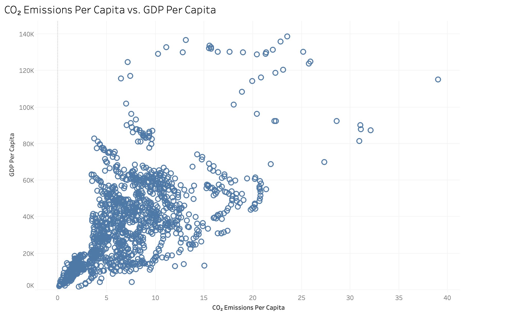
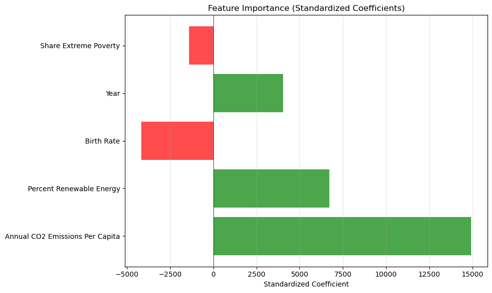
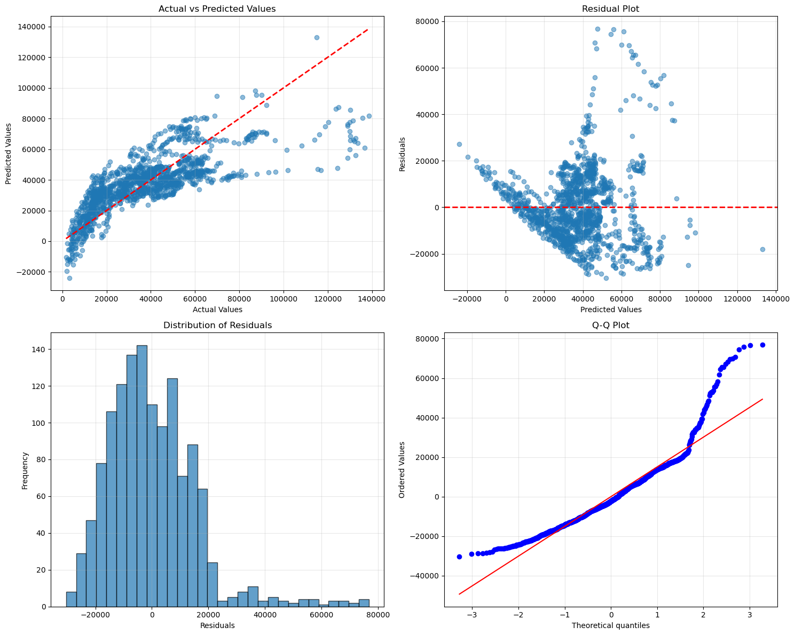

# CO₂ Emissions and GDP Per Capita: Regression Analysis

## Project Overview

How are CO₂ emissions and selected socioeconomic indicators associated with GDP per capita across the countries and years represented in the dataset?

This was a 7-person team project completed across Business Analytics and Data Driven Decision Making coursework. We sourced country-level data, explored it visually in Tableau, and fit a multiple linear regression of GDP per capita on CO₂ emissions per capita, year, birth rate, renewable energy share and the share of the population in extreme poverty.

## Data

- **1,308 country-year observations** covering **70 countries** from **1990 to 2023**.
- No dataset was provided. The team researched and sourced the data online from [Our World in Data](https://ourworldindata.org/), which compiles series from underlying providers such as the World Bank.
- Separate indicator files were joined on country and year into [data/final_dataset.xlsx](data/final_dataset.xlsx).
- GDP per capita is in international dollars (adjusted for inflation and purchasing power).
- Coverage varies by country, from a single year to all 34, so the findings describe the countries in this dataset, not the world as a whole.

Source pages: [CO₂ emissions per capita](https://ourworldindata.org/grapher/co-emissions-per-capita), [birth rate](https://ourworldindata.org/grapher/crude-birth-rate), [GDP per capita](https://ourworldindata.org/grapher/gdp-per-capita-worldbank), and the Our World in Data topic pages for [renewable energy](https://ourworldindata.org/renewable-energy) and [poverty](https://ourworldindata.org/poverty).

## Approach

1. **Exploratory analysis:** descriptive statistics, a correlation matrix, and Tableau scatterplots of each indicator against GDP per capita.
2. **Regression:** a multiple linear regression (pooled OLS) in Python, with predictors standardized so their coefficients can be compared by relative size.
3. **Diagnostics:** residual plots and checks for normality, constant variance, multicollinearity and influential points.

## Key Findings

- **CO₂ emissions per capita had the strongest positive association with GDP per capita** of the five predictors in the fitted model.
- **The model explained roughly 58% of the variation in GDP per capita** within this sample (R² ≈ 0.58).
- Year and renewable energy share were also positively associated with GDP per capita; birth rate and extreme poverty were negatively associated.
- The diagnostics show the limits of a simple linear model: prediction errors widen as predicted income rises, and the highest-income observations are fit poorly.

## Visuals

**CO₂ emissions per capita vs. GDP per capita** (Tableau). Higher-emitting country-years tend to have higher GDP per capita, with wide spread at the top.

**Standardized coefficients from the final model.** Bars show the relative size and direction of each predictor's association with GDP per capita.

**Model fit and residual diagnostics.** Predicted values track actual values for most observations but fall short at the high end.

## Interpretation

Economic output, emissions and socioeconomic conditions move together across these countries and years. That does not mean increasing emissions raises GDP. Wealthier economies consume more energy, so the relationship plausibly runs from income to emissions as well, and factors outside the model, such as industrial structure and natural resources, influence both.

The practical value is descriptive: the model summarizes how strongly these indicators are tied to income levels and shows where a simple linear model stops being adequate.

## Limitations

- The results are associations from observational data, not causal effects.
- Pooled OLS does not account for country-specific differences or for repeated observations of the same countries, so the reported precision is likely overstated.
- The sample is unbalanced: some countries contribute far more years than others.
- Model fit was evaluated on the same data used to fit the model.

## My Contribution

Within the 7-person team, my contribution focused on the data work, the regression modeling and the Tableau visualization, completed in collaboration with a teammate.

## Repository Contents

| Path | Contents |
|---|---|
| [notebooks/co2_gdp_regression_analysis.ipynb](notebooks/co2_gdp_regression_analysis.ipynb) | Regression models, diagnostics and predictions, saved with outputs |
| [docs/co2_gdp_regression_analysis_report.pdf](docs/co2_gdp_regression_analysis_report.pdf) | Submitted team report |
| [data/final_dataset.xlsx](data/final_dataset.xlsx) | Merged country-year dataset |
| [images/](images/) | Charts used in this README, exported unchanged from the notebook and report |
| [requirements.txt](requirements.txt) | Python packages used by the notebook |

The submitted course report is preserved as the original project artifact; this README uses more precise associational language when describing the regression results.

**Running the notebook:** the notebook is preserved as submitted and expects `final_dataset.xlsx` in its working directory, while this repository stores it under `data/`. Executing it from the current structure therefore needs a small path or working-directory adjustment. Its saved outputs can be read without running it.

## Tools

Python (pandas, NumPy, scikit-learn, SciPy, statsmodels, Matplotlib, seaborn), Jupyter, Tableau.
